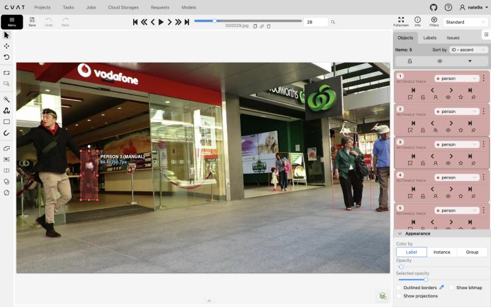
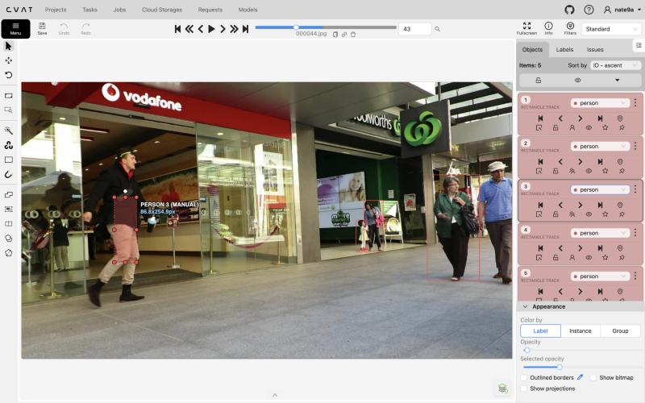
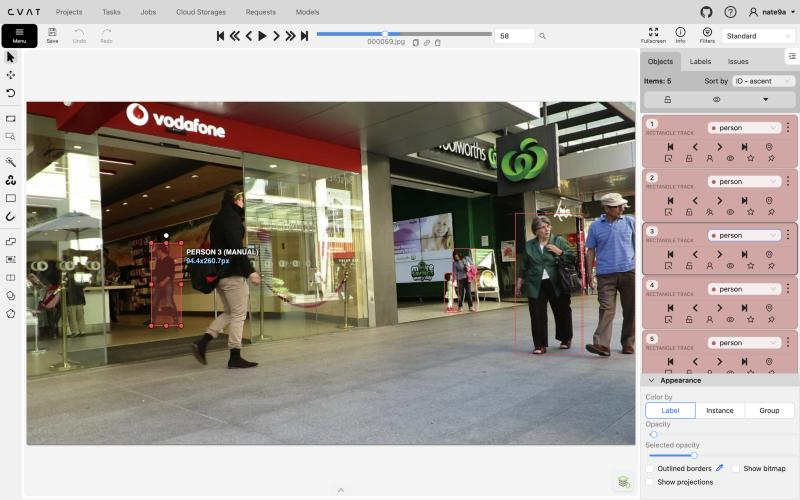

# Báo cáo cá nhân — TranQuangNam-2A202603118

Đoạn video: MOT17-09, 150 frame (frame 1–150), nguồn MOTChallenge, giấy phép CC BY-NC-SA 3.0.

## 0. Thông tin học viên

- Họ tên: Trần Quang Nam
- MSSV: 2A202603118
- Mã đề (A/B/C): B (task `DAY05-MOT17-09-B-2A202603118`)
- Email:
- Link repository: https://github.com/trannam229/K5-L2-DAY05-TranQuangNam-2A202603118-MOTTracking
- Giờ bắt đầu: 16:30
- Giờ kết thúc: 17:40

## 1. Xem trước đoạn video (CP0)

Ghi **trước khi vẽ**, mỗi người một dòng.

| Mã | Frame xuất hiện | Frame cuối thấy được | Rẽ / dừng / đổi tốc độ ở frame | Bị che ở frame | Ghi chú |
|---|---|---|---|---|---|
| P1 | 0 | 149 | Đi sang phải 0–90, chậm lại và quay ra ~100, lại gần camera sau 90 | 32–54 (anh áo đen đi ngang trước) | Ở trong cửa hàng Vodafone, sau kính |
| P2 | 0 | 149 | Đi chéo về trái, lại gần camera; tăng tốc sau ~55 | Không | Box to dần (cao 341 → 769 px) |
| P3 | 0 (ở mép phải) | 149 | Vào khung từ mép phải 0–25, sau đó đi về trái, lại gần camera | 0–64 (cắt mép khung, P2 che một phần) | Box to nhanh nhất (cao 172 → 886 px) |
| P4 | 0 | 148 | Đi sang phải 0–30 rồi đứng yên | 110–139 (P2 đi ngang), 149 (P3) | Bé gái, đứng cạnh P5 |
| P5 | 0 | 139 | Đi sang phải 0–30 rồi đứng yên | 105–139 (P2), 140–149 (P3) | Mẹ đeo túi hồng, sát P4 |

## 2. Keyframe và thời gian (CP1, CP4)

Số keyframe lấy từ kết quả `src/check_submission.py`. Cột thời gian: _(tự điền)_.

| Mã | Số keyframe | Keyframe ở frame | Số frame có mặt | Keyframe / 100 frame | Thời gian (phút) | Chỗ khó |
|---|---|---|---|---|---|---|
| P1 | 10 | 0, 18, 32, 55, 67, 76, 92, 104, 132, 149 | 150 | 6.7 | | Đoạn bị che 32–54, quay đầu ~100 |
| P2 | 7 | 0, 53, 77, 106, 131, 140, 149 | 150 | 4.7 | | Lại gần camera, box đổi kích thước |
| P3 | 10 | 0, 23, 65, 71, 72, 79, 97, 116, 131, 149 | 150 | 6.7 | | Vào khung từ mép, box to rất nhanh |
| P4 | 7 | 0, 16, 54, 92, 110, 136, 140 | 125 | 5.6 | | Nhỏ, bị P2 rồi P3 che kín |
| P5 | 8 | 0, 29, 52, 86, 105, 126, 135, 137 | 126 | 6.3 | | Sát P4, hai lần bị che kín |
| **Tổng** | 42 | | 701 | 6.0 | | |

Keyframe / 100 frame của cả bài = tổng keyframe ÷ tổng số frame có mặt × 100 = 42 ÷ 701 × 100 = 6.0

Bạn đặt keyframe nhiều nhất ở người nào? Vì sao (người đó rẽ, dừng, lại gần camera hay bị che)?

P1 và P3 (10 keyframe). P3 vừa vào khung từ mép vừa lại gần camera nên kích thước box đổi không tuyến tính. P1 bị che ở 32–54 và đổi hướng quanh frame 100. P4, P5 ít keyframe vì gần như đứng yên.

## 3. Đoạn bị che (CP2)

Người bị che: `P1`

| Mốc | Frame |
|---|---:|
| Bắt đầu bị che một phần (bật `occluded`) | 32 |
| Mất hẳn (bật `outside`) | Không có |
| Hiện lại (tắt `outside`) | Không có |
| Thấy rõ trở lại (tắt `occluded`) | 55 |

- Thời gian khuất hẳn: 0 frame = 0 giây (bị che một phần 23 frame ≈ 0,77 giây).
- Quyết định: giữ cùng ID.
- Lý do: P1 không lúc nào mất hẳn, khuất một phần 23 frame, dưới ngưỡng 60 frame. Dáng và quần áo trước, sau khớp nhau. Sau đoạn che P1 vẫn đi sang phải với tốc độ cũ, không có ai khác ở vị trí đó.

Ngoài ra P4 (khuất hẳn 112–135, 24 frame) và P5 (112–125, 14 frame) đều dưới 60 frame nên cũng giữ cùng ID.

Ảnh chụp màn hình:





## 4. Tự review ID (CP3)

Lượt 1 theo người (đi ngược từ frame 149 về 0 trên CVAT), lượt 2 theo cảnh (nhảy 10 frame). Ít nhất 3 dòng; không có lỗi thì ghi một dòng "đã kiểm hai lượt, không lỗi".

Loại lỗi dùng đúng một trong 7 mã: `id_switch`, `fragmentation`, `lost`, `merge`, `false_track`, `drift`, `flag`.

| Frame | Mã người | Loại lỗi | Mô tả một câu | Phát hiện ở lượt | Đã sửa? |
|---:|---|---|---|---|---|
| 0 | (người ngoài đề) | `false_track` | Track cho anh áo đen quần be bên trái, người này không thuộc đề B | 2 | Có, đã xóa |
| 41 | (người ngoài đề) | `false_track` | Track cho cô áo trắng trong Vodafone, không thuộc đề B | 2 | Có, đã xóa |
| 0 | P4 | `lost` | Bé gái ở cửa Woolworths chưa có track | 2 | Có, đã gán |
| 2 | P5 | `lost` | Người mẹ đeo túi hồng chưa có track | 2 | Có, đã gán |
| 113–128 | P4 | `flag` | Bị P2 che kín nhưng để `occluded` thay vì `outside` | 1 | Có |
| 112–125, 140–149 | P5 | `flag` | Bị P2, P3 che kín nhưng để `occluded` thay vì `outside` | 1 | Có |

Tổng hợp số lỗi theo loại:

| `id_switch` | `fragmentation` | `lost` | `merge` | `false_track` | `drift` | `flag` |
|---:|---:|---:|---:|---:|---:|---:|
| 0 | 0 | 2 | 0 | 2 | 0 | 2 |

Lỗi nào chỉ lượt 2 (theo cảnh) mới thấy, lượt 1 (theo người) không thấy? Vì sao?

Hai `false_track` và hai `lost`. Lượt 1 chỉ đi theo từng track đã có, nên track nào cũng "bám đúng người" của nó; phải nhìn cả cảnh và đối chiếu bảng nhận diện mới thấy hai track đang bám nhầm người ngoài đề và hai người của đề chưa có track.

## 5. File xuất và kết quả tự kiểm (CP4)

| Kiểm tra | Kết quả |
|---|---|
| Tên file MOT 1.1 | `src/exports/TranQuangNam_mot.zip` |
| Tên file CVAT for video 1.1 | `src/exports/TranQuangNam_cvat_video.zip` |
| Số track ID khác nhau trong `gt/gt.txt` (phải là 5) | 5 |
| Frame `outside` không có dòng trong `gt.txt` (đúng / sai) | Đúng (P4 vắng frame 112–135, 149; P5 vắng frame 112–125, 140–149) |
| Job đã completed trên CVAT máy cá nhân | _(tự điền sau khi chuyển)_ |

Dán phần tóm tắt in ra từ `src/check_submission.py`:

```text
=== Tóm tắt ===
  Lỗi: 0   |   Cảnh báo: 0
  Đạt. Dán phần tóm tắt này vào báo cáo mục 5.
```

## 6. Ba câu kết

1. Nếu được gán lại, bạn sẽ đặt keyframe khác ở đâu? Vì sao?

   Thêm keyframe dày hơn cho P3 ở 0–25 (lúc vào khung, chiều cao box tăng gấp đôi trong 20 frame) và cho P2 sau frame 110 (tăng tốc, box to nhanh). Nội suy tuyến tính giả định tốc độ đổi kích thước không đổi nên trôi ở đó.

2. Có chỗ nào bạn không chắc "cùng ID hay ID mới"? Bạn đã quyết định và ghi chú thế nào?

   Có, ở P4/P5 sau frame 112: hai mẹ con đứng sát nhau và bị P2 che kín, khi hiện lại dễ gán nhầm box mẹ cho con. Tôi giữ cùng ID vì khuất dưới 60 frame, cùng vị trí, kích thước box khác nhau rõ (bé cao ~125 px, mẹ ~200 px).

3. Một lỗi ID trong job của bạn (nếu không còn sót, chọn lỗi đã sửa) có thể làm xe tự lái dự đoán sai chuyển động của người đó như thế nào? Lỗi đó ảnh hưởng MOTA hay IDF1 nhiều hơn?

   Lỗi `lost` ở P4 (bé gái chưa có track): mô hình học từ nhãn này sẽ coi chỗ đó không có người, xe không dự đoán được em bé có thể bước ra đường từ sau người lớn. Lỗi này là FN nên ảnh hưởng MOTA nhiều hơn IDF1 (không phải lỗi đổi ID).

## Bonus (nếu làm)

### B1 — Hai người đi sát

...

### B2 — So cách đặt keyframe

| Cách đặt | Số keyframe | Frame trôi nhất | Ghi chú |
|---|---:|---:|---|
| Đều mỗi 30 frame | | | |
| Theo chỗ đổi hướng | | | |

...

### B3 — So với tracker có sẵn

| Frame | Mã người | Tracker làm gì | Nhãn của bạn | Giải thích (đoán rồi sửa / ghép IoU / box score thấp / ngoại hình) |
|---:|---|---|---|---|
| | | | | |
| | | | | |

## 7. Tài liệu tham khảo và công cụ AI đã dùng

- Dữ liệu: MOT17, MOTChallenge (Milan et al., 2016), CC BY-NC-SA 3.0.
- Claude Code (trợ lý AI): hỗ trợ cài đặt môi trường và tạo task CVAT, chạy `src/check_submission.py`, đối chiếu track với bảng nhận diện đề B, điền số liệu keyframe từ kết quả script vào mục 2 và mục 5.
